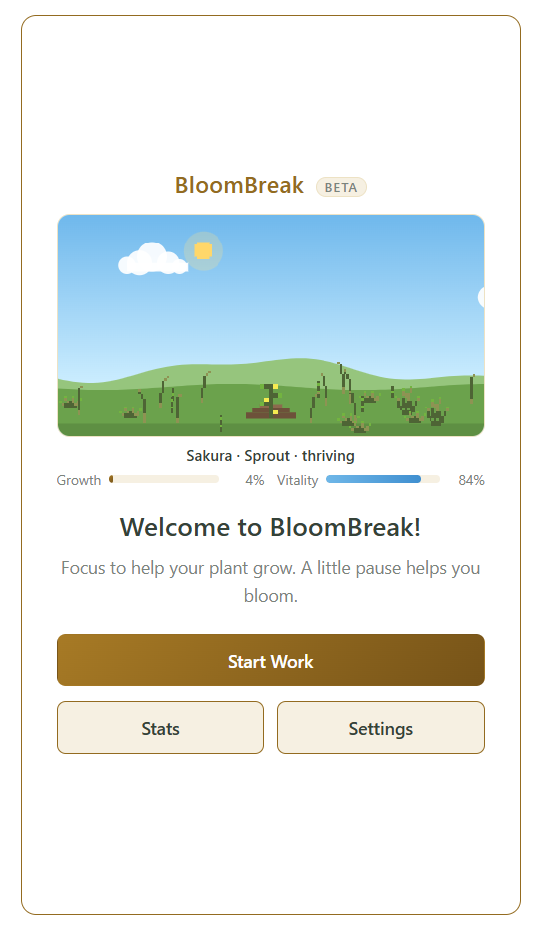
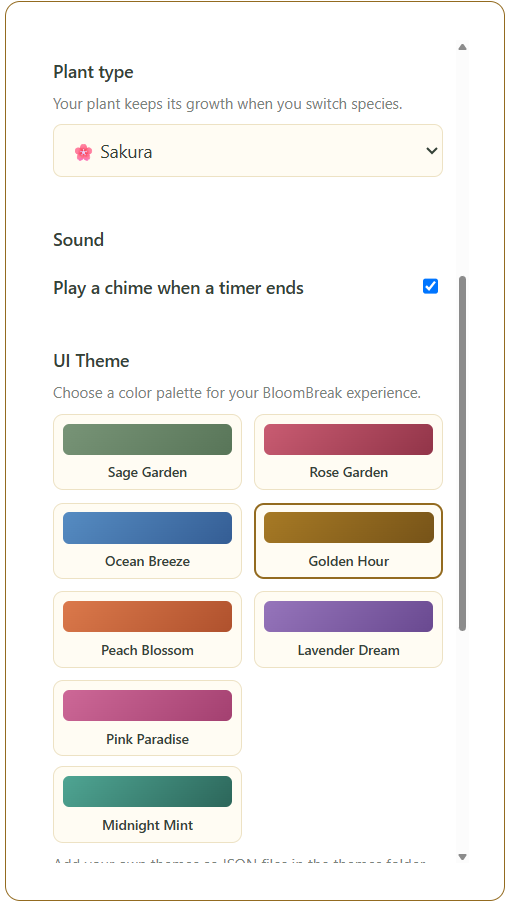
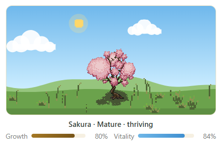
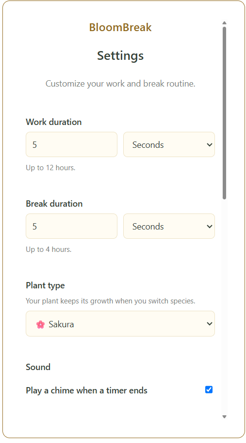
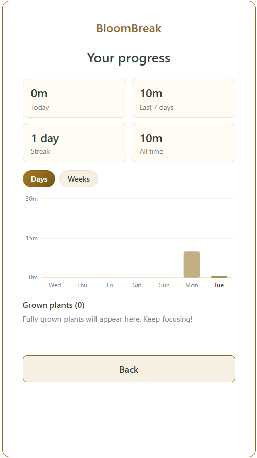

# BloomBreak 🌱

A friendly desktop break reminder with virtual plants.

## About

BloomBreak is a Windows desktop productivity application that encourages users to take regular breaks during focused work.

Combining customizable work and break timers with an interactive virtual garden, BloomBreak turns taking breaks into a small, rewarding experience. Users can water their plants, maintain their vitality, and watch them grow while building healthier work habits.

## Features

- **Customizable timers** — Set your own work and break durations.
- **Interactive virtual plants** — Water plants and watch them grow through different stages.
- **Plant vitality** — Maintain your plant's vitality through regular interaction.
- **Multiple plants** — Choose from different plant types.
- **Customizable themes** — Switch between available application themes.
- **Desktop notifications** — Receive notifications when work or break sessions end.
- **System tray integration** — Keep BloomBreak running in the background.
- **Windows startup option** — Configure the application to launch when Windows starts.
- **Productivity statistics** — Track your focus activity.
- **Custom themes support** — Add your own themes using JSON files.

## Technologies

- JavaScript
- HTML
- CSS
- Node.js
- Electron
- Electron Forge

## Installation

### Download the application

Download the latest Windows installer from the [Releases](https://github.com/sabrina7963/BloomBreak/releases) page.

Run the installer and follow the installation instructions.

### Run from source

1. Install [Node.js](https://nodejs.org/).
2. Clone this repository.
3. Open the project directory in a terminal.
4. Install the dependencies:

   ```bash
   npm install
   ```

5. Start the application:

   ```bash
   npm start
   ```

## Project status

BloomBreak 1.1.0 — Initial production release.

## Screenshots

### Main Interface


### Plants and Themes


### Plant Growth


### Timer Settings


### Productivity Statistics


## License

License information will be added soon.
